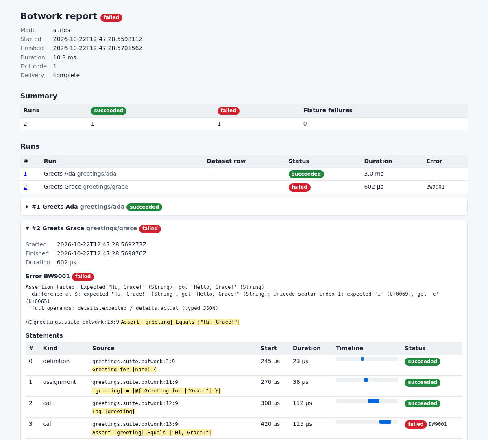

# botwork

botwork is a single-binary automation framework, written in Rust, for acceptance
testing, acceptance test-driven development (ATDD), and robotic process
automation (RPA). A script is a list of sentence-like statements with their
parameters between pipes, so a test reads like the behavior it checks. Names,
identifiers, and text can be written in any language (see
[multilingual authoring](docs/language.md#multilingual-authoring) and the
[Tamil and accented-text example](examples/16-multilingual.botwork)); control
keywords, operators, and numbers keep one fixed syntax. Statements can be
written in botwork itself, Rust, Python, JavaScript, or WebAssembly. It is a
fast, lightweight alternative to Robot Framework.

## Why botwork?

I have used Robot Framework for a few years. It is a great framework, but a few
things about it bother me:

1. It needs Python (and a virtualenv) to run. That takes more space, in
   container images for instance, and more memory. Python is the love of my
   life, but it is slow and resource-heavy.
2. The syntax could be simpler. Its separator of two or more spaces and its
   `${}` and `@{}` variables confuse people who are new to it.
3. It is mostly extensible only with Python.

I wanted:

1. An efficient, fast, single-binary tool.
1. A simpler syntax than Robot Framework's.
1. Extensions in Rust, Python (via PyO3), JavaScript (via a Node worker), and
   WebAssembly (via WASI).
1. A proper language definition, with a PEG parser.
1. LSP and Tree-sitter support.
1. Most of all, to have fun building something that I can introduce to my kids.

## Install

From 0.3.0, each [GitHub release](https://github.com/dhilipsiva/botwork/releases)
carries the `botwork` binary for Linux x86_64 (static, with no dependencies),
macOS arm64, and Windows x86_64, and a `SHA256SUMS` file. On Linux:

```sh
version=0.3.0
base=https://github.com/dhilipsiva/botwork/releases/download/v$version
archive=botwork-v$version-x86_64-unknown-linux-musl.tar.gz
curl -fL --remote-name-all "$base/$archive" "$base/SHA256SUMS"
sha256sum --check --ignore-missing SHA256SUMS
tar -xzf "$archive" botwork
./botwork --version
```

Move `botwork` to a directory on your `PATH`, such as `~/.local/bin`.
[Installation and distribution](docs/distribution.md#releases) covers the other
platforms, the package managers, and verifying a download's build provenance.
0.3.0 is the first release of this implementation. Until it is published, or
to build the latest code, install from source with a stable Rust toolchain:

```sh
git clone https://github.com/dhilipsiva/botwork.git
cd botwork
cargo install --path . --locked
```

## A 30-second example

Save this as `greetings.suite.botwork`:

<!-- botwork-test: readme-suite -->
```botwork-suite
Suite |"greetings"| Named |"Greetings"| {
    Library {
        Greeting for |name| {
            Return |"Hello, " + name + "!"|
        }
    }
    Case |"ada"| Named |"Greets Ada"| {
        Assert |@{ Greeting for |"Ada"| }| Equals |"Hello, Ada!"|
    }
    Case |"grace"| Named |"Greets Grace"| {
        |greeting| = |@{ Greeting for |"Grace"| }|
        Log |greeting|
        Assert |greeting| Equals |"Hello, Grace!"|
    }
}
```

The `Library` defines a statement, `Greeting for |name|`, and each `Case` is a
named test that calls it. Run the suite and write an HTML report:

```sh
botwork --suite greetings.suite.botwork --report-html report.html
```

Progress and the summary go to stderr and `Log` goes to stdout. Cases run in
parallel, so the order of the lines can vary:

```text
[case greetings/ada] started: "Greets Ada"
[case greetings/ada] succeeded: "Greets Ada"
[case greetings/grace] started: "Greets Grace"
Hello, Grace!
[case greetings/grace] succeeded: "Greets Grace"
[cases] 2 selected: 2 succeeded, 0 failed
```

Change Grace's expected greeting to `"Hi, Grace!"` and run it again. The run
now exits with status 1, the console names the failing statement and the
difference, and `report.html` opens on the failure, with its source, statements,
and timings:

<!-- Made from this suite with the change above: botwork --suite
greetings.suite.botwork --report-html report.html, then a headless Chrome
screenshot of report.html at 1200x1082. -->


[Getting started](docs/getting-started.md) goes further: a first script, reading
a failure, and a complete acceptance-test workflow with datasets, setup, and CI
reports.

## Documentation

The [documentation index](docs/README.md) lists every page, including the
[command-line reference](docs/cli.md), [configuration](docs/configuration.md),
[reports and outputs](docs/reporting.md), [extending Botwork](docs/extending.md),
[installation and distribution](docs/distribution.md), and
[compatibility](docs/compatibility.md).
The [syntax reference](docs/syntax.md) lists every form a script or suite can use,
and the [statement reference](docs/statements.md) lists every built-in statement.
`--check` [finds mistakes without running](docs/check.md) a file or suite,
`--format` rewrites files in [canonical layout](docs/format.md), and `--lsp`
runs a [language server](docs/lsp.md), packaged with highlighting for
[Helix, Vim, and VS Code](docs/editors.md).
[CONTRIBUTING.md](CONTRIBUTING.md) explains how to build, test, and send a change.

## What botwork does

In a checkout, `cargo run -- --file examples/02-syntaxes.botwork` runs the
syntax tour, and [examples/](examples) has many more scripts and suites.

`Log` writes readable values to stdout. Diagnostics go to stderr, and uncaught
script errors return a nonzero exit status. Add `--debug` after `cargo run --`
to trace top-level statement locations on stderr. See [language behavior](docs/language.md)
and [testing instructions](docs/testing.md) for the implemented contracts.

Repeat `--file` and set `--jobs` to run scripts concurrently with independent
state, for example `cargo run -- --file examples/21-parallel-first.botwork --file
examples/22-parallel-second.botwork --jobs 2`. See [parallel CLI execution](docs/parallel-cli.md)
for run IDs, ordering, per-run limits, and failure behavior.

Use `--suite examples/23-named-cases.suite.botwork` for named acceptance cases.
Add `--list-cases`, select with `--case` or `--tag`, and save `--failures failed.json`
for a later `--rerun-failed failed.json`. See [parameterized cases and reusable datasets](docs/parameterized-cases.md)
for independent row execution, and [named suites](docs/suites.md) for
stable IDs, library declarations, discovery order, and case isolation.

For complete tasks, [build a verified catalogue or check an HTTP response contract](docs/automation-examples.md).
Both examples combine imported helpers, JSON input variables, assertions, and
standard statements, with runnable local fixtures and failure demonstrations.

Batch and suite runs end with a [console report](docs/console-report.md): a recap of
failed, timed-out, and stopped work, then a summary whose counts match the exit status.
Add `--report-json report.json` for a versioned [JSON report](docs/json-report.md)
that CI can consume. It records the same verdict and exit status, every run's
statements, logs, errors, and artifacts, and a [schema](docs/json-report.schema.json)
to validate against. `--report-html PATH` renders the same results as a
self-contained [HTML report](docs/html-report.md), with source excerpts, timings,
logs, and artifact links. `--listener PROGRAM` streams the same execution events live
to a [report listener](docs/listeners.md), as JSON Lines on its stdin. The stream
has defined ordering, and slow or failing listeners are detached without slowing
the runs.
Every started run ends with exactly one [terminal outcome](docs/terminal-outcomes.md).
Ctrl-C cancels started runs cooperatively and still publishes the reports.
`--reconcile-report PATH` finishes reports after a forced termination, marking
unfinished runs as interrupted. Every report output has a documented
[limit](docs/report-limits.md), so large suites and long loops keep reports
bounded.
Runs are [isolated](docs/run-isolation.md): they share only the parsed trees of
unchanged imported modules, and each builds its own module state.
Stops reach nested statements, I/O, listeners, and cleanup, and runs release
their resources afterwards; see [cancellation](docs/cancellation.md).
A stopped run returns within its [shutdown bound](docs/shutdown.md), even when a
system call cannot be interrupted: blocked work is abandoned after
`--stop-grace-ms` (2 seconds by default).
[Stress repetition](docs/stress.md) runs deterministic isolation and cancellation
scenarios 1,000 times each and checks every outcome and released resource.
Mark inputs as [secrets](docs/secrets.md) with `--secret NAME` or
`--secret-env NAME=VARIABLE`. Their values are then masked as `***` in logs,
diagnostics, traces, reports, listener events, and artifacts.

Embedded hosts can request a versioned [run record](docs/run-records.md) of each run's
statements, logs, timing, and outcome through `RunOptions::record`.

Convert JSON and CSV test data with `Parse JSON`, `Format JSON`, and `Parse CSV`,
or read suite rows directly with `Dataset |"id"| From JSON |"rows.json"|`. See
[structured data](docs/structured-data.md) for the conversion rules.

Wait for eventual conditions with `Eventually` and repeat side-effecting actions with
`Retry`. Both use bounded [deadlines, attempts, and backoff](docs/polling.md) and
report the last failure together with the recent attempt history.

[Assertion diagnostics](docs/assertion-diagnostics.md) show nested value differences
and case/dataset identity. Add `--assertion-artifacts PATH` to retain full permitted
operands from unhandled assertions in separate JSON files.

Default [source and syntax limits](docs/syntax-limits.md) reject oversized inputs before parsing or execution.
[Runtime budgets](docs/embedded-runs.md#cli-and-low-level-contexts) stop excessive steps and recursion;
configure `--max-steps`, `--max-call-depth`, `--max-evaluation-depth`, and cooperative `--timeout-ms`.
[Output budgets](docs/output-limits.md) admit each complete record before writing;
configure `--max-output-record-bytes` and `--max-output-bytes` for logs, traces, and statement help.

Use `cargo run -- --list-statements` to list built-ins, or
`cargo run -- --statement-help 'Log |value|'` for parameter/return kinds and errors.
Rust hosts can [register statements with checked signatures](docs/interpreter-architecture.md#shared-signature-metadata).
[Typed isolated operations](docs/worker-protocol.md) run external workers on Linux with bounded requests, results, diagnostics, and supervised cancellation. Optional [process-tree guardians](docs/isolated-workers.md#process-tree-guardians) reap detached descendants and clean up after host termination.
Use the [embedded Engine](docs/embedded-runs.md) for fresh runs with local variables,
directory/environment configuration, cooperative cancellation, budgets, and structured results.
Use [call expressions](docs/language.md#calls-inside-expressions), such as `@{Double |3|}`,
to compose statement results inside other expressions.
[Local modules](docs/language.md#local-modules) use `Import |"helpers.botwork"| As |helpers|`
and qualified calls such as `helpers::Double |3|`.

Supply [input variables](docs/input-variables.md) from JSON files and repeatable overrides.
[Input budgets](docs/input-variables.md#input-resource-budgets) bound reads and decoded values before execution:

```sh
cargo run -- --file examples/20-input-variables.botwork \
  --vars-file examples/inputs/defaults.json --var 'name="Ada"' --var 'attempts=3'
```

[Retained-value budgets](docs/retained-values.md) bound variable storage across calls,
modules, and cloned contexts, releasing capacity when stored values are dropped.
[Definition budgets](docs/retained-definitions.md) also account for installed DSL
definitions and shared source text across repeated evaluations.
[Variable-name budgets](docs/retained-names.md) bound key storage and share it
across Context and module snapshots.
[Registry budgets](docs/retained-registry.md) cover statement/namespace metadata,
including native templates and imported wrappers. [Snapshot budgets](docs/snapshot-limits.md)
admit frame/cache copies before table allocation and define host Clone ownership.
[Result budgets](docs/result-limits.md) admit owned terminal/root exports, transfer
unique payloads, and report omitted snapshots explicitly.
[Temporary budgets](docs/temporary-limits.md) cover live expressions, arguments,
collection construction, and operand/output overlap across calls and modules.

## Sample code

This script defines a statement and calls it. Save it as `sample.botwork` and
run it with `botwork --file sample.botwork`:

<!-- botwork-test: readme-sample -->
```botwork
# Declaration
What is the square of |number| divided by |divisor| equals, eh?!... {
	|square| = |number ^ 2|
	Return |square / divisor|
}

# Invocation (case-insensitive, with flexible spacing)
|answer| = WHAT is  the   sQuAre of |6| divided by|2|equals, EH?!...

Log |"Here is your answer:"|
Log |answer|
```

## Roadmap to version 1.0

Version 0.3.0 implements everything checked below. Until 1.0, a release may
still change the language, the statements, the output formats, the CLI, and the
Rust API ([before 1.0](docs/compatibility.md#before-10)). [TODO.md](TODO.md) has
the detailed plan, and the [roadmap decisions](docs/decisions.md) record the
choices that shape it.

- [x] Basic syntax
  - [x] Statements
  - [x] If condition
  - [x] For & While loop
  - [x] Basic arithmetic and logical operations
  - [x] Datatypes: int, float, string, bool, array, map
  - [x] Try/Catch and [awaited Finally cleanup](docs/cleanup.md)
  - [x] [Suite and case setup/teardown](docs/fixtures.md)
  - [x] Custom statements
  - [x] [Map and Array access](docs/language.md#collection-access)
  - [x] [Imports of local botwork files](docs/language.md#local-modules)
  - [x] Imports of [WebAssembly files](docs/wasm.md) and [packages](docs/packages.md)
  - [x] [Imports from URL](docs/packages.md#files-by-url), pinned and fetched ahead of runs
- [x] Docs
  - [x] README
  - [x] [Getting started docs](docs/getting-started.md)
  - [x] [Syntax docs](docs/syntax.md)
  - [x] [Statement docs](docs/statements.md)
- [x] More statements out of the box (like the ones Robot Framework offers)
  - [x] [Built-ins](docs/builtins.md)
  - [x] [Collections](docs/collections.md)
  - [x] [Datetime](docs/datetime.md)
  - [x] [Operating system](docs/operating-system.md)
  - [x] [Process](docs/processes.md)
  - [x] [Strings](docs/strings.md)
  - [x] [Making HTTP Requests](docs/http.md)
  - [x] [JSON and CSV data](docs/structured-data.md)
- [x] Integrations
  - [x] Selenium/Webdriver ([D11](docs/decisions.md#d11-browser-and-mobile-integrations)); see [browser automation with WebDriver](docs/webdriver.md)
  - [x] Appium ([D11](docs/decisions.md#d11-browser-and-mobile-integrations)); see [mobile automation with Appium](docs/appium.md)
  - [x] Playwright ([D11](docs/decisions.md#d11-browser-and-mobile-integrations)); see [browser automation with Playwright](docs/playwright.md)
- [x] Reports
  - [x] [Console Reports](docs/console-report.md)
  - [x] [JSON Reports](docs/json-report.md)
  - [x] [HTML Reports](docs/html-report.md)
  - [x] [Report listeners](docs/listeners.md)
- [x] Tooling
  - [x] [LSP support](docs/lsp.md)
  - [x] [Editor support](docs/editors.md) (Helix, Vim, Neovim, VS Code)
  - [x] [TreeSitter grammar](docs/tree-sitter.md)
  - [x] [Linting](docs/check.md)
  - [x] Python extension support (via PyO3, [D9](docs/decisions.md#d9-python-packaging)); see [Python statements](docs/python.md)
  - [x] JavaScript extension support (via an out-of-process Node worker, [D7](docs/decisions.md#d7-javascript-hosting)); see [JavaScript statements](docs/javascript.md)
  - [x] WASM extension support (via Wasmtime and WASI, [D8](docs/decisions.md#d8-wasm-runtime)); see [WebAssembly statements](docs/wasm.md)
- [x] CLI
  - [x] Ability to pass variables from CLI / Files
  - [x] [Run in parallel](docs/parallel-cli.md)
- [x] Fully async, non-blocking operations ([async execution](docs/async-execution.md), [nonblocking I/O](docs/nonblocking-io.md))
- [x] [Unit tests with at least 50% coverage](docs/testing.md)
- [ ] The [1.0 readiness gates](TODO.md#10-verify-10-readiness): the interpreter
  refactoring finished, the coverage, mutation, and fuzzing thresholds met, the
  usability sessions run, the contracts stabilized, and two independent reviews
  passed

After 1.0 comes a trusted and verified registry for botwork packages
([D10](docs/decisions.md#d10-packages-and-registry)).

## License

Licensed under either of

- the Apache License, Version 2.0 ([LICENSE-APACHE](LICENSE-APACHE)), or
- the MIT license ([LICENSE-MIT](LICENSE-MIT)),

at your option. Unless you explicitly state otherwise, any contribution
intentionally submitted for inclusion in botwork by you, as defined in the
Apache-2.0 license, shall be dual licensed as above, without any additional
terms or conditions.
